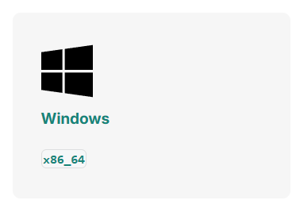
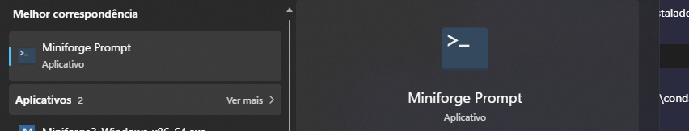
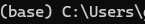
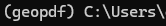

# Instruções para Processar o GeoPDF

Este guia orienta o processo de configuração do ambiente para permitir a execução do arquivo `execute.bat`.

---

## 1. Download e Instalação do Miniforge <a name="mini-forge"></a>

A escolha pelo **Miniforge** se deve às restrições de usuário em ambientes corporativos, eliminando a necessidade de privilégios de administrador que seriam exigidos para instalar soluções como o WSL (Ubuntu 24 LTS). Ele traz um ambiente de desenvolvimento minimalista com os recursos essenciais para utilizar o Conda e o Mamba para ler e coletar dados embutidos em um `GEO_PDF`.

*   **Link para download:** [Conda-Forge Download](https://conda-forge.org/download/)
*   **Repositório oficial:** [GitHub - Miniforge](https://github.com/conda-forge/miniforge)
*   **Versão de referência:** `26.7.2-0` (Última versão em 20/10/2026)

> 💡 No site, escolha a opção de download para **Windows (x86_64)**.
> 

>Siga as instruções e baixe o Miniforge com tudo default.
---

## 2. Configuração do Ambiente Miniforge

Após concluir a instalação do utilitário, siga as etapas abaixo para preparar o ambiente de execução:

### Passo 1: Abrir o Prompt do Miniforge
1. Na barra de pesquisa do Windows, procure por **Miniforge Prompt**. <br>
   

2. Abra o aplicativo normalmente (**não** utilize a opção "Executar como administrador").

### Passo 2: Executar os Comandos de Preparação
Com o terminal aberto, execute a sequência de comandos abaixo:

1. **Criar o ambiente virtual** com o Python 3.12 e a biblioteca GDAL:
   ```bash
   conda create -n geopdf -c conda-forge python=3.12 gdal
   ```

2. **Ativar o ambiente** criado:
   ```bash
   activate geopdf
   ```
   *Note que o indicador do terminal mudará de `(base)` para `(geopdf)`.*
   
- 
- 


3. **Instalar o driver** necessário para leitura de PDFs:
   ```bash
   conda install -c conda-forge libgdal-pdf
   ```

4. **Validar a instalação** e os drivers disponíveis:
   ```bash
   python -c "from osgeo import gdal, ogr, osr; print('GDAL:', gdal.VersionInfo('--version')); print('Driver PDF:', gdal.GetDriverByName('PDF'))"
   ```

### Resultado Esperado da Validação
O retorno no terminal deve ser semelhante ao exemplo abaixo:
```text
GDAL: GDAL 3.13.3 "Iowa City", released 2026/08/13
Driver PDF: <osgeo.gdal.Driver; proxy of ...>
```

Já pode fechar o Miniforge prompt.

---

## 3. .BAT
O arquivo `executar.bat` foi programado para abrir o terminal do Miniforge atravez da função `call`, entretanto ele busca o conda.bat para abrir o terminal atravez do endereço "%USERPROFILE%\AppData\Local\miniforge3\condabin\conda.bat", ou seja é possivel ajustar onde ele procura o `conda.bat` caso se tenha feito uma instalação customizada do Miniforge. 
Para visualizar o que o `executar.bat` faz pode ser ler alterando a extensão do arquivo para `.txt` ou abrir o arquivo copia dele que já está no formato de `.txt`, diante disso é altamente recomendado que caso altere o `executar.bat` tambem se uma nova copia dele atualizada para o formato `.txt`.  
Dando continuidade, o `executar.bat` vai usar o terminal do Miniforge já com o `geopdf` ativo e ele vai tentar executar o arquivo `processar_geoPdf.py`, logo, se tiver uma alteração no nome do script `.py`,
 se deve atualizar ea chamada desse arquivo no `executar.bat`.  
Outro ponto importante a se manter, são os modificadores que aparecem antes do nome do arquivo (`%~dp0`), usando como exemplo o "%~dp0processar_geopdf.py":  
Se separarmos os blocos de %~dp0, você verá o %0 escondido ali:
1. A borda externa (% e 0): O primeiro % e o 0 no final formam o argumento original %0 (que representa o próprio arquivo).
2. O modificador interno (~dp): O til ~ avisa ao Windows que você vai aplicar modificadores, e o d (drive) junto com o p (path) são as instruções para extrair o caminho.

> � Isso garante que o Windows vai encontrar o arquivo processar_geoPdf.py desde que ele esteja na mesma pasta que o arquivo .bat, não importa de onde você execute o script.

---

## 4. Script para processar Geo PDF

O `processar_geopdf.py` foi desenvolvido para utilizar a biblioteca gdal, ela esta disponível no repositorio default do linux, sem a necessidade de baixar um repositorio novo da internet. Entretanto nesse fluxo o desenvolvimento foi pensado para aqueles que não tem Linux e não partir da necessidade de instalação virtual do Linux (Exigiria senha de ADMIN). 
Fluxo -> Baixar o [Miniforge](#mini-forge) para instalar um ambiente de desenvolvimento que tenha o gdal (SEM admin required!).

O `processar_geopdf.py` faz:
1. Lê o GeoPDF: abre o arquivo e identifica o mapa e as informações disponíveis nele.

2. Gera uma imagem do mapa: transforma o mapa do PDF em uma imagem PNG, mantendo sua localização geográfica.

3. Extrai os pontos: coleta os pontos encontrados no PDF e suas informações, como os atributos disponíveis.

4. Organiza os dados: salva as informações do mapa e dos pontos em um arquivo JSON.

5. Gera um ZIP: reúne a imagem PNG e o arquivo JSON em um único arquivo ZIP, pronto para ser utilizado no aplicativo.

6. Limpa os arquivos temporários: remove os arquivos intermediários criados durante o processamento.

7. O resultado é um arquivo ZIP contendo a imagem do mapa e os dados dos pontos, facilitando a importação dessas informações para o aplicativo.

---

## 5. Resumo de uso
Após fizer a instalação do Miniforge, para usar o `processar_geopdf.py` basta clicar no `executar.bat`, escolher pelo Explorador de Arquivos do Windows o `GeoPDF.pdf` e em poucos segundos dentro da mesma pasta onde esta o `GeoPDF.pdf` que foi escolhido sera criado um `GeoPDF.zip` e dentro dele: `GeoPDF.png` e `GeoPDF.json`. Para o aplicativo, basta importar o `GeoPDF.zip` que o proprio  app se resposabilizara de ler o `.json` e posicionar o `.png` sobre o Mapa do Flutter ou qualquer outro mapa que suporte posicionar imagens sobre ele.


------
# FIM.